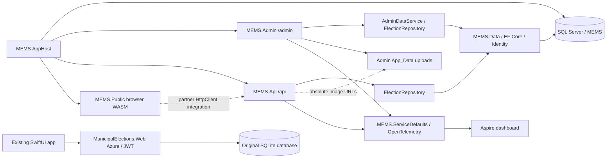
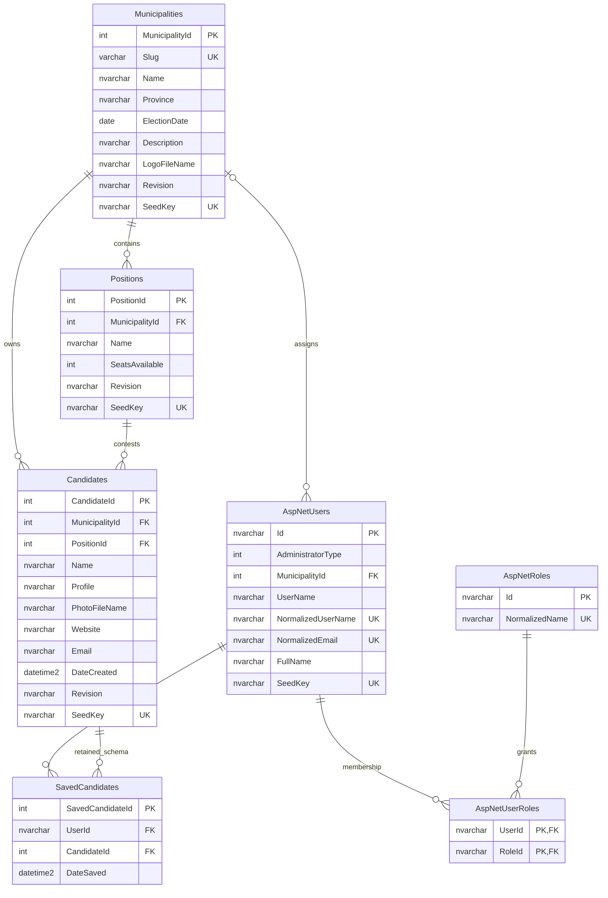

# Assignment 2 backend, administration, and infrastructure report

Validation date: 16 November 2026 (America/Los_Angeles). This report covers the
backend/infrastructure/Admin responsibilities. Existing Assignment 1 documents
are preserved as historical records; their completion statements do not describe
the new Assignment 2 public website or cloud deployment.

## Scope and available evidence

The workspace contains all seven MEMS projects, the original MVC/SQLite/JWT
application, and SwiftUI sources. No COMP4976/COMP4977 Assignment 2 PDFs or
instructor feedback were found. Requirements were checked against the supplied
Task 1–4 instructions; official PDF compliance and feedback closure still need
instructor material. No Git changes were committed/pushed and no Azure deployment
was performed in this milestone.

## Architecture



- **AppHost:** references Admin/Api/Public and provisions a persistent local SQL
  Server container plus the `MEMS` database. Aspire supplies `ConnectionStrings__MEMS`
  to Api/Admin. SQL readiness precedes API migration startup; API `/health`
  readiness precedes Admin/Public startup. All three apps explicitly use their
  HTTPS profiles independently of the dashboard profile.
- **ServiceDefaults:** server-side service discovery, resilient HttpClients,
  structured OpenTelemetry logging, HTTP/runtime metrics, incoming/outgoing HTTP
  tracing, and development `/health` and `/alive` endpoints. Api/Admin additionally
  enrich their existing SQL EF contexts with Aspire database health/SQL tracing.
  The WASM browser does not reference server ServiceDefaults.
- **Admin:** .NET 10 Interactive Server, Bootstrap, Identity, fresh EF context per
  operation. It calls the shared repository directly through `AdminDataService`;
  it does not duplicate API business rules or forward users' cookies through a
  shared server HttpClient. An activity from `MEMS.Data` covers each data operation.
- **Api:** stable DTOs in Shared, public tenant-scoped reads, authorized CRUD,
  antiforgery-protected Identity cookie sessions, safe Problem Details, and
  `/openapi/v1.json` in Development.
- **Public:** currently the official standalone WASM template. API readiness is
  complete; municipality pages and voting-guide UI remain the partner's work.
- **Legacy/iOS:** SQLite, original MVC, HMAC JWT auth and Azure deployment stay
  separate. Neither credentials nor record IDs are interchangeable with MEMS.

Endpoint references configure the exact Public HTTPS CORS origin and Admin HTTPS
image origin in the API. Server-side discovery variables are provided by
`WithReference`; browser code must explicitly configure a reachable API URL.

## Run Aspire and seed development data

Prerequisites: .NET 10 SDK, Docker Desktop with Linux containers running, and
the pinned Aspire AppHost SDK/client packages restored by NuGet. A global Aspire
CLI is optional because this AppHost uses the SDK's CLI bundle. The first SQL
container run downloads Microsoft's SQL Server 2022 image and creates a volume.

Configure five distinct development passwords in **AppHost user secrets** using
`dotnet user-secrets set --project MEMS.AppHost "<key>" "<value>"`:

| Account | AppHost secret key |
| --- | --- |
| Super | `Parameters:seed-super-password` |
| Burnabyadmin | `Parameters:seed-burnaby-password` |
| Surreyadmin | `Parameters:seed-surrey-password` |
| Richmondadmin | `Parameters:seed-richmond-password` |
| pm | `Parameters:seed-pm-password` |

Use at least 12 characters with upper/lowercase, a digit and a symbol. Do not
paste secrets into a report, screenshot, Git-tracked settings, or logs. Local
verification generated these five secrets in the current user's AppHost secret
store without printing their values. Set your own values before creating a new
development database. Re-seeding an existing account does **not** reset its password.
Aspire manages the separate SQL server password as a secret parameter.

From `COMP4976-MunicipalElections-CSharp`:

```powershell
dotnet restore MEMS.sln
$env:Mems__Seed__Enabled = 'true'
dotnet run --project MEMS.AppHost --launch-profile https
# After stopping the AppHost:
Remove-Item Env:Mems__Seed__Enabled
```

The seed switch is optional and defaults to false. Only the API runs the opt-in
Development initializer when orchestrated; it applies Code First migrations and
EF's locked, repeatable seed hook before serving requests. Startup failure stops
dependent apps instead of serving an uninitialized database. Admin never runs
competing migrations. Published configuration disables this automatic initializer
and refuses publishing development seed parameters. Production migration and
account provisioning must use a reviewed maintenance process.

Default browser endpoints (use the dashboard if port settings change):

| Service | URL |
| --- | --- |
| Admin | `https://localhost:7052/admin` |
| API | `https://localhost:7249` |
| Public template | `https://localhost:7158` |
| HTTPS dashboard | `https://localhost:17275` plus its private login token |

The local machine's development certificate is **untrusted**. The first HTTPS
dashboard attempt ran the API/SQL but could not connect the dashboard to the
resource service (`UntrustedRoot`). Certificate trust was not changed. Local
verification instead used the existing HTTP dashboard profile with
`ASPIRE_ALLOW_UNSECURED_TRANSPORT=true`, bound to localhost, while the three apps
retained HTTPS. With an installed Aspire CLI the explicit noninteractive command
is:

```powershell
$env:ASPIRE_ALLOW_UNSECURED_TRANSPORT = 'true'
aspire run --apphost MEMS.AppHost/MEMS.AppHost.csproj --launch-profile http --non-interactive
# Dashboard: http://localhost:15243, using the private login URL printed locally.
# Remove the environment override after stopping:
Remove-Item Env:ASPIRE_ALLOW_UNSECURED_TRANSPORT
```

The bundled CLI can also be used by `dotnet run --project MEMS.AppHost
--launch-profile http` with that environment override. Browser HTTPS trust still
needs normal local setup for manual login; the automated browser tests ignore
certificate errors only in their test contexts. Never disable production TLS
verification or publish the dashboard's private login URL/token.

Status-only development `/health` and `/alive` probes accept local HTTP without
redirecting; all other API/Admin routes retain HTTPS redirection and secure
cookies. Health responses contain status only, not SQL connection details.

For direct standalone migration/run commands, see [Data setup](../MEMS.Data/README.md),
[API setup](../MEMS.Api/README.md), and [Admin setup](../MEMS.Admin/README.md).
Standalone hosts each need their own secure connection configuration; AppHost
supplies it automatically only to its managed child processes. Do not reset the
SQL volume to rerun seeding. Preserve volume/password configuration together.

## Database and updated ERD



The ERD abbreviates Identity's standard password/security, claims, logins, tokens
and role-claim columns/tables; all standard Identity schema remains in the EF
migration. No hashes or security stamps are API DTO fields. Revision is a
32-character concurrency token, generated again on updates.

The crucial candidate relationship is the **composite FK**
`(PositionId, MunicipalityId) -> Positions(PositionId, MunicipalityId)`; tenant
and position cannot disagree even in direct SQL. Parent municipality/position
deletes restrict dependent records; administrator assignments also restrict
municipality deletion. Positive seats, nonblank text, slug syntax, unique slugs,
municipality name/province, position name per tenant, Identity membership and
filtered unique email/seed markers protect integrity. Municipal administrator
rows require one municipality; Super Admin/ordinary users require no assignment.

The existing Task 1 migration includes the retained `SavedCandidates` model.
It is unused by the new public website and has no MEMS API write/read endpoints.
Task 4 adds no tables or endpoints for voting selections. Public voting-guide
selections must use **browser `sessionStorage` only**, isolated by municipality.
The original legacy saved-candidate endpoints remain for Assignment 1 compatibility.

Development seeding produces five municipalities, 15 positions, 32 fictional
candidates, two roles, and five administrators. Burnaby, Surrey, Richmond each
have Mayor/Councillor/School Trustee and eight candidates. Pitt Meadows/Maple
Ridge and the `pm` account accommodate the old samples. `Super` also accepts
the original `super` spelling through Identity normalization. Stable seed keys
prevent duplicates while preserving edits, renamed accounts, and password hashes.

## API contract and public partner handoff

The complete resource/authentication matrix, request/response examples, revision
requirements, validation/error examples, and OpenAPI setup are in
[MEMS.Api/README.md](../MEMS.Api/README.md). The source contracts are
`MEMS.Shared/Contracts/ElectionContracts.cs` and `AuthenticationContracts.cs`.

Each of municipalities/positions/candidates supports collection/detail GET,
POST, PUT, and DELETE. The public integration calls below require **no login**:

```http
GET https://localhost:7249/api/municipalities
GET https://localhost:7249/api/municipalities/slug/burnaby
GET https://localhost:7249/api/positions?municipalitySlug=burnaby
GET https://localhost:7249/api/candidates?municipalitySlug=burnaby
GET https://localhost:7249/api/candidates/search?municipalitySlug=burnaby&name=reese
GET https://localhost:7249/api/candidates?municipalitySlug=burnaby&positionId=<returned-position-id>
GET https://localhost:7249/api/candidates/<returned-id>?municipalitySlug=burnaby
```

Resolve IDs dynamically. `municipalityId` can replace the slug; supplying both
must identify the same tenant. Candidate responses include biography (`profile`),
`photoUrl`, email/website, creation time, municipality and position IDs/names and
nested DTOs. Configured Aspire image URLs point to the Admin host's validated
public `/uploads` assets. Seeded images are optional; null URLs require a UI
placeholder. No old MVC image files are migrated.

The partner must:

1. Add their `/burnaby`, `/surrey`, `/richmond` routing and unknown-city state.
   The slug identifies the API tenant; it does not provide administrative access.
2. Configure a browser-safe API base URL, e.g. a public `ApiBaseUrl` setting with
   `https://localhost:7249` in local development. Configure their typed/named
   HttpClient to read that setting; the existing template HttpClient currently
   points at the public site's own origin. Do not point it at `https+http://api`
   or expect process environment variables to appear in the WASM browser.
3. Preserve their existing component work. `MEMS.Public` source/configuration was
   not modified in this milestone. Aspire injects the exact Public origin into
   API CORS. Outside Aspire, configure `Cors:AllowedOrigins` explicitly.
4. Include `municipalitySlug` or ID on **every** anonymous candidate/position
   collection/detail request, and reset filters/selections when changing city.
   Name search accepts at most 100 characters; position IDs must match the city.
5. Render safe loading/error/empty/image-placeholder states. Use returned image
   URLs directly and account for optional contacts/photos. Do not expose Admin
   cookies or credentials through client configuration.
6. Keep voting selections in tenant-keyed `sessionStorage`, e.g.
   `mems:guide:burnaby`. Do not add SQL/API/Firestore persistence for C# selections.
7. Run browser end-to-end tests and verify CORS, image loading, city changes and
   reload/session behavior once their election frontend exists.

Public requests without a candidate/position tenant return 400. Unknown tenants
return 404. IDs outside the selected tenant return 404. Validation produces
`application/problem+json`; authorization failures return 401/403 and conflicts
409. A safe `traceId` links failures to diagnostics, without stack traces.

## Authentication and tenant enforcement

Api/Admin share the new SQL Identity store and `AdministratorScopeResolver`,
but have separate secure cookies/data-protection application names. Login is
username/email plus configured password, with lockout/throttling. Writes require
Identity authorization; API writes also require the paired CSRF cookie/header.
The Admin uses antiforgery-protected HTTP login/logout forms and a 30-minute
absolute session lifetime. Logout rotates the security stamp for all MEMS sessions
of that user. Two-factor-enabled accounts are refused; a 2FA challenge/enrollment
UI is not implemented.

Super Admin can manage all tenants. Municipality Administrators can view their
own municipality and manage its positions/candidates, but cannot create/edit/delete
tenants. The request/circuit principal identifies the user; current stored roles,
type, municipality, lockout and security stamp determine authority. Body/route
municipality IDs never grant scope. Services check stored owners and destination
positions; EF query filters and save guards enforce the same boundary. Defaults
without a resolved tenant are fail-closed. Offline migration/seeding explicitly
uses a separate privileged context rather than weakening request/circuit filters.

## Observability and manual evidence

In the authenticated local Aspire dashboard:

1. **Resources:** verify sql/MEMS/api/admin/public are running. Api/Admin `/health`
   include SQL connectivity; `/alive` checks process liveness. Start time and
   dependency wait state show migration/startup ordering.
2. **Console:** select `api` to inspect migration/seed completion and startup
   errors; select `admin` for operation failures. SQL's console is its container
   log. Do not reveal secret parameters or private dashboard URLs in captures.
3. **Structured logs:** filter resource `api` or `admin`, then make an API request
   or save an Admin record. Inspect level, timestamp, structured fields and trace
   correlation. No application code logs credentials or request bodies.
4. **Traces:** request a scoped candidate directory/detail and save an Admin
   record. Inspect the incoming API HTTP span with SQL client children and the
   `MEMS.Data` Admin-operation activity with SQL work. Health probes are excluded
   from HTTP trace instrumentation. Admin's direct data path does not invent an
   Admin-to-API HTTP call.
5. **Metrics:** select API/Admin HTTP/runtime instruments. OTLP exporting is
   configured by Aspire only when its endpoint is present. Standalone services
   still have their logging/health instrumentation.

Capture genuine screenshots manually for submission: the resources graph/healthy
states; API/Admin structured logs and a trace detail; Super Admin dashboard and
each municipality's scoped counts; CRUD/validation/upload and denied cross-tenant
screens; successful test/build output; SQL Server tables, migration history and
seed counts (omit hashes/security stamps). Include Public city pages only after
the partner implements them. No screenshots are invented in this report.

## Existing Azure/iOS backend and Firebase

Source inspection confirms SwiftUI's `APIClient.swift` uses the original Azure
origin and `/api/auth/register`, `/api/auth/login`, `/api/candidates`,
`/api/municipalities`, and the existing saved-candidate routes. It already passes
`municipalityId` when fetching city candidates. The server's optional `city` and
municipality/position filters extend the same routes; field names/types match
the existing Swift `Models.swift`. There is no separate election entity to invent.

Local SQLite HTTP tests cover registration/login, JWT claims and security-stamp
revocation, saved-record ownership, candidate/position retrieval, changing cities,
invalid filters and Swift-compatible nested responses. The legacy source, Azure
workflow/configuration and all SwiftUI files are preserved in Task 4.

A read-only Azure probe on the validation date returned HTTP 200 and four
municipalities. `GET /api/municipalities?city=mems-invalid-city` also returned
HTTP 200; the locally patched API expects 404. Therefore reachability is verified,
but the deployed site's filter behavior is not yet confirmed compatible with
Task 2. No Azure registration/login, credentialed request, deployment, or iOS
device run was performed. Treat the deployment/filter discrepancy as outstanding.

Before cloud sign-off, publish **MunicipalElections.Web**, not MEMS.Api, using
the existing deployment workflow/authorized Azure process. Keep persistent SQLite,
upload storage and secure `ConnectionStrings:DefaultConnection`/JWT configuration.
With authorized Azure credentials, deploy the reviewed legacy publish artifact,
then repeat: municipality directory; valid/unknown/conflicting city filters;
candidate/position/detail consistency; disposable test-user registration/login;
valid, expired and forged JWT behavior; saved-record ownership; and the existing
SwiftUI client against its configured Azure origin. Record HTTP results and a
device/simulator run without exposing tokens or creating permanent sample users.

Firebase remains a separate backend/client dependency. An ASP.NET JWT cannot
directly authenticate Firestore rules. No Firebase signing identity/project or
emulator configuration was supplied; no untested token-exchange endpoint is
claimed. The secure UID mapping, custom-token exchange, ownership rules and exact
partner/backend work are described in [the iOS handoff](ASSIGNMENT2-IOS-API.md).
Use verified JWT `sub`/database user ID, never a posted email/UID. Firestore
frontend work remains the partner's responsibility.

## Deficiency review and resolutions

No instructor feedback was available. The following are **code-review findings**,
not attributed instructor criticisms:

| Finding / original behavior | Resolution | Verification |
| --- | --- | --- |
| MVC/SQLite architecture lacked the Assignment 2 shared SQL tenant boundary | Tasks 1–3 introduced SQL EF, composite ownership FK, current Identity scope and Blazor Admin | SQL constraints, repository/filter, API and Admin security tests |
| Initial AppHost lacked SQL/dependency readiness | Managed SQL/connection references, API initializer, SQL health and ordered startup | Live Aspire resources and SQL tests |
| HTTP dashboard profile implicitly selected HTTP-only child profiles, making HTTPS image/CORS references unresolved | Explicit HTTPS profile for all child apps | Live startup and HTTPS browser/API checks |
| Direct navigation could check deletion confirmation before Blazor became interactive | Disable confirmation and delete controls until circuit readiness | Live browser CRUD regression |
| API allowed election dates outside the MVC/Admin 2000–2100 rule | Moved the shared date rule into `MunicipalityRequest`, reused by Admin/API | API rejection tests and existing Admin validation tests |
| Credentials/tenant authorization could be trusted from stale UI state or posted IDs | Current database assignment/stamp validation, service checks, EF filters/save guards | Forged-ID/filter/write and revocation tests |
| Public/API image origins were disconnected under orchestration | API image base URL references Admin HTTPS endpoint | Live uploaded image fetch through API response URL |

When feedback/PDFs are supplied, check each actual finding against validation,
role/tenant access, malformed/duplicate/dependent records, upload restrictions,
concurrency, safe errors, required admin actions, public routes/sessionStorage,
and iOS/Firestore/cloud expectations. Record the actual instructor wording,
resolution commit/files and fresh verification evidence; leave UI work with
its owner.

## Test results and reproducibility

Final verification completed against Docker SQL Server 2022 and the running
Aspire application, with .NET SDK 10.0.401 / runtime 10.0.12 on Windows:

| Check | Final observed result |
| --- | --- |
| `dotnet restore MEMS.sln` | Passed |
| Debug solution build | Passed, 0 warnings / 0 errors |
| Release solution build | Passed, 0 warnings / 0 errors |
| Release `MEMS.Data.Tests` | 27 passed, including live SQL integration |
| Release `MEMS.Api.Tests` | 33 passed, including isolated legacy SQLite/JWT HTTP compatibility |
| Release `MEMS.Admin.Tests` | 22 passed, including Chromium and live Aspire/Admin/SQL/API integration |
| Total automated tests | **82 passed, 0 failed, 0 skipped** with live settings enabled |
| EF pending-model check | No changes since the initial migration |
| Idempotent SQL migration script | Generated successfully in ignored `MEMS.Data/obj/InitialSqlServer.sql` |
| SQL migrations/seeding | Up/down/reapply, both seed hooks, repeated seeds and integrity guards passed in isolated generated databases |
| Live Admin/API | CRUD, update/delete, images and cleanup, slug/search/position filters, four administrator scopes, anonymous denial and cross-tenant denial passed |
| Public integration readiness | Browser fetch from Public origin passed CORS and returned only Burnaby candidates; election UI remains a template |
| Aspire observability | Five resources running; Admin/API structured logs and HTTP/SQL traces populated; Admin HTTP/Identity/SignalR/runtime metric instruments available |
| Preserved source | No diffs in original MVC, SwiftUI, Public, original READMEs/ERD, or Azure workflow |
| Azure | Read-only directory reachable; invalid-city HTTP 200 discrepancy remains; no deployment/authenticated verification |

Intermediate failures were not silently discarded: missing design-time
connection configuration was corrected by supplying the secure test environment;
the untrusted HTTPS dashboard used the documented localhost HTTP fallback;
explicit child HTTPS profiles fixed endpoint resolution; disabled pre-interactive
confirmation fixed the live deletion race. One isolated browser test timed out
during the initial concurrent full suite, then passed alone. The two heavy
browser walkthroughs now run sequentially; the final full solution suite above
passed. No tests were removed or skipped to obtain the result.

Generated TRX results are at each test project's ignored
`TestResults/task4-release.trx`. Full restore/build/test logs are under ignored
`MEMS.AppHost/obj/task4-*.log`. These files are local evidence, not source artifacts
to commit; the report records their final counts.

```powershell
dotnet restore MEMS.sln
dotnet build MEMS.sln --no-restore
dotnet build MEMS.sln --configuration Release --no-restore
dotnet test MEMS.sln --configuration Release --no-build
```

Live SQL tests require `MEMS_TEST_SQLSERVER`, supplied securely with permission
to create/drop **isolated generated test databases**. They never drop or migrate
the database named in that setting. The existing test proves migration up/down,
repeat seeding, raw SQL integrity constraints, concurrency and tenant query/save
guards. Use a disposable local SQL instance, not a production account/database.

The live Aspire test in `MEMS.Admin.Tests/AspireBackendTests.cs` is opt-in:

- Start the AppHost with the documented seed accounts and install Chromium using
  `pwsh MEMS.Admin.Tests/bin/Release/net10.0/playwright.ps1 install chromium`.
- Set `MEMS_TEST_ASPIRE=true`, `MEMS_TEST_ADMIN_URL`, `MEMS_TEST_API_URL`,
  `MEMS_TEST_PUBLIC_URL` (normally `https://localhost:7158`), plus
  `MEMS_TEST_SUPER_PASSWORD`, `MEMS_TEST_BURNABY_PASSWORD`,
  `MEMS_TEST_SURREY_PASSWORD`, `MEMS_TEST_RICHMOND_PASSWORD` securely.
- Run the solution tests. The live browser test creates uniquely named temporary
  municipality/position/candidate records, edits/deletes them, fetches public
  API results/images, verifies browser CORS from the Public template's origin,
  tests all four admin scopes, and cleans its own records. The two browser
  walkthroughs run in a nonparallel collection to avoid competing for local
  browser/server resources during the test suite.
  It assumes the original eight seeded candidates/three positions per target
  city, so use the development fixture before altering those seeded records.
- Missing live settings produce explicit skips. Report them; InMemory tests
  cannot prove SQL constraints, migrations, or transactions. Test-only certificate
  bypass applies only to local Playwright contexts.

Migration scripts and pending-model checks:

```powershell
dotnet tool restore --tool-manifest dotnet-tools.json
dotnet ef migrations has-pending-model-changes --project MEMS.Data --startup-project MEMS.Data
dotnet ef migrations script --idempotent --project MEMS.Data --startup-project MEMS.Data --output MEMS.Data/obj/InitialSqlServer.sql
```

Build/test logs and local browser screenshots are ignored generated artifacts,
not committed evidence. The final report records pass/fail counts and scope.

## Changed files in this milestone

- `MEMS.AppHost/AppHost.cs`, `MEMS.AppHost.csproj`: managed SQL/database,
  dependency/connection references, exact HTTPS profiles, CORS/image origins,
  optional secret seed parameters and SQL hosting package.
- `MEMS.Api/Program.cs`, `MEMS.Api.csproj`: EF SQL enrichment, opt-in local
  initializer and status-only HTTP health probing; `MEMS.Admin/Program.cs` and
  `MEMS.Admin.csproj`: matching SQL enrichment/health and cache headers.
- `MEMS.ServiceDefaults/Extensions.cs`: register the shared data activity source.
- `MEMS.Data/Configuration/MemsDatabaseInitializer.cs` and
  `MEMS.Data/Observability/DataTelemetry.cs`: explicit maintenance initialization
  and activity source. No new database migration/schema was needed.
- `MEMS.Shared/Contracts/ElectionContracts.cs`, `MEMS.Admin/Models/AdminModels.cs`:
  share the original election-date validation across API and Admin.
- `MEMS.Admin/Services/AdminDataService.cs`: trace data operations;
  `Components/Pages/{Candidates,Municipalities,Positions}/Details.razor`: wait for
  interactivity before deletion confirmation/actions.
- `MEMS.Admin.Tests/AspireBackendTests.cs`, `BrowserTests.cs`,
  `MEMS.Api.Tests/AdminApiTests.cs`, `MEMS.Data.Tests/SqlServerIntegrationTests.cs`:
  live integration, serialized browser tests, date validation and actual SQL
  tenant query/save guard coverage.
- `MEMS.Api/README.md`, `MEMS.Admin/README.md`, `MEMS.Data/README.md`: update the
  Assignment 2 run/integration guidance; this report and root
  `.github/copilot-instructions.md` are new.

No tracked source files were removed in Task 4. No original Assignment 1 files,
Public/SwiftUI files, existing Azure workflow, solution membership or EF schema
were changed. Generated build/test/upload/log files remain ignored.

## Requirement status and submission actions

| Responsibility | Status |
| --- | --- |
| Seven-project references and local Aspire SQL orchestration | Implemented and run |
| SQL connection injection, migrations, repeat seeding, required sample records | Verified against SQL Server 2022 |
| Admin CRUD, uploads, scoped dashboard and login/logout | Verified through services, HTTP and Chromium |
| API CRUD/contracts/search/filtering/slug resolution and safe errors | Verified locally |
| Super Admin plus Burnaby/Surrey/Richmond tenant isolation | Verified in live Admin/API and EF/SQL tests |
| Logging, tracing, health and dashboard integration | Implemented and observed locally |
| Public API readiness and browser CORS | Verified without changing Public source |
| Public municipality pages and `sessionStorage` voting-guide behavior | Partner implementation pending; no end-to-end election UI claim |
| Existing iOS response/JWT compatibility | Source comparison and local SQLite HTTP tests passed |
| Azure deployment and credentialed iOS backend verification | Outstanding; invalid-city discrepancy observed on live directory |
| Firebase custom-token exchange and Firestore security/client integration | Outstanding configuration and implementation/testing handoff |
| Assignment PDF/instructor-feedback compliance | Unverified because source material is unavailable |
| Architecture/ERD/API/test/deficiency/AI documentation | Prepared with explicit limitations |

Before submission:

1. Obtain both assignment PDFs and actual instructor feedback; complete the
   feedback checklist with real evidence.
2. Have the partner implement/configure the Public election routes and voting
   guide, then run the public browser checks above. The backend adds no public
   voting-selection persistence.
3. Reconcile/deploy the reviewed legacy Azure backend using authorized access
   and perform the credentialed API/iOS verification described above.
4. Supply Firebase project/signing configuration; implement/test the secure
   server exchange and partner client/rules together before claiming completion.
5. Resolve local development certificate trust for manual HTTPS use or use the
   documented local dashboard fallback; keep production TLS verification enabled.
6. Restart Aspire with Docker/seed secrets as needed and capture the genuine
   dashboard/Admin/API/SQL screenshots listed above. Retain database/uploads
   backups and do not expose secret/token fields in submission artifacts.
7. Review the Git diff and make the submission commit only when explicitly
   authorized. This milestone creates no commit, push, or cloud deployment.

## AI assistance / Copilot usage

This work used the **Codex coding assistant** in this conversation. No evidence
of GitHub Copilot sessions, telemetry, previously used prompt files, or repository
skill files was supplied/found. Do not report Copilot usage as established fact.
The newly added root [`.github/copilot-instructions.md`](../../.github/copilot-instructions.md)
is prospective repository guidance, not proof of historical Copilot use.

Actual user prompts available in the conversation include “Migrate the MEMS Data
Layer to SQL Server”, “Implement MEMS APIs, Authentication, and Tenant Security”,
“Migrate the MVC Admin Application to Blazor Server”, and “Complete Aspire
Integration, Backend Testing, and Documentation”. They specified preservation,
tenant security, validation, tests, no commits/pushes and clear limitations.
There were no additional invoked skill/prompt files to attach for Task 4.

Assistance accelerated source/controller/Swift contract comparison, project
wiring, shared validation, test generation and execution, and documentation
cross-checking. No measured time savings are claimed. Problems encountered were
untrusted local certificates, inherited HTTP profiles resolving missing HTTPS
endpoints, transient build locks while apps were running, and a delete-confirmation
hydration race. Runtime/browser tests exposed issues that source inspection alone
did not establish. Final verification must remain factual and independent of
assistant claims.
