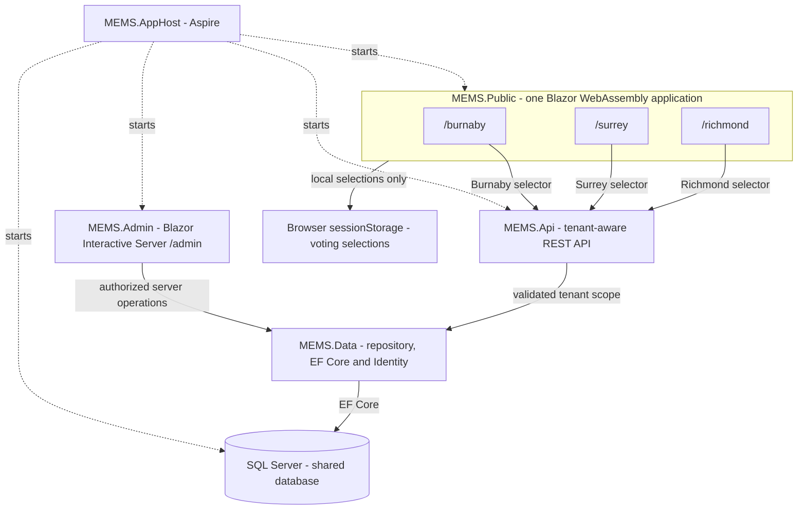

# C# architecture

The seven-project .NET 10 solution runs locally through Aspire. The Admin and
public sites share election data, but use different access paths.

## Project responsibilities

| Project | Responsibility |
| --- | --- |
| `MEMS.AppHost` | Starts SQL Server, API, Admin and Public; supplies connection strings, startup dependencies, CORS and image origin. |
| `MEMS.ServiceDefaults` | Shared server logging, tracing, health checks and service discovery. Used by API and Admin. |
| `MEMS.Admin` | Shared `/admin` UI, Identity login, tenant-aware dashboard, CRUD and image uploads. |
| `MEMS.Public` | Municipality routes, directory, search, candidate details, browser voting guide and printing. |
| `MEMS.Api` | JSON contracts, public directory reads, authenticated administrative writes and safe errors. |
| `MEMS.Data` | SQL Server entities, migrations, seed data, Identity stores and authorized repository operations. |
| `MEMS.Shared` | Browser-safe request/response contracts, validation and shared identity constants. |

## Startup and observability

Aspire starts SQL Server in a Docker container with a persistent data volume.
The API waits for SQL Server, applies migrations and seeds in the Development
launch profile. Admin and Public wait for the API. Aspire supplies the database
connection; no SQL credentials belong in checked-in configuration.Use the dashboard's resource list, structured logs and traces to inspect requests and database activity. 

The iOS Azure API and its SQLite database are separate from this architecture.

