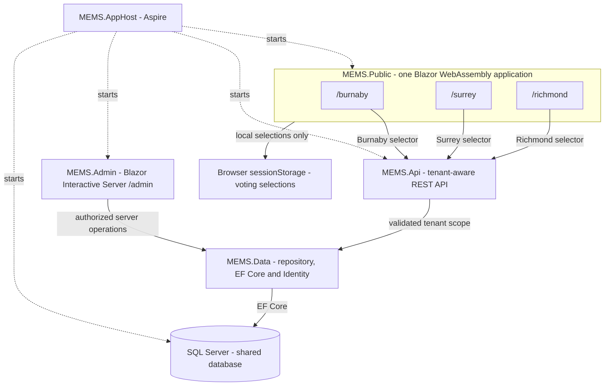

# C# architecture

The seven-project .NET 10 solution runs locally through Aspire. The Admin and
public sites share election data, but use different access paths.

## Project responsibilities

| Project | Responsibility |
| --- | --- |
| `MEMS.AppHost` | Starts SQL Server, API, Admin and Public; supplies connection strings, startup dependencies, CORS and image origin. |
| `MEMS.ServiceDefaults` | Shared server logging, tracing, health checks and service discovery. Used by API and Admin. |
| `MEMS.Admin` | Shared `/admin` UI, Identity login, tenant-aware dashboard, CRUD and image uploads. |
| `MEMS.Public` | Municipality routes, directory, search, candidate details, browser voting guide and printing. |
| `MEMS.Api` | JSON contracts, public directory reads, authenticated administrative writes and safe errors. |
| `MEMS.Data` | SQL Server entities, migrations, seed data, Identity stores and authorized repository operations. |
| `MEMS.Shared` | Browser-safe request/response contracts, validation and shared identity constants. |

Admin calls `AdminDataService` and the shared repository directly on the server.
It does not send its browser cookie through an API `HttpClient`. Each operation
uses a fresh service scope/context and validates the current administrator.
The public browser calls the API using anonymous read requests.

## Tenant isolation

One database stores all municipalities. A unique slug resolves each public URL
to a municipality ID. Anonymous position/candidate requests must select that
municipality; nested response data must belong to it too.

Super Admin can manage every municipality. A Municipality Administrator has
exactly one stored assignment and cannot change scope by posting another ID.
API authorization, repository ownership checks, EF query filters/write guards,
and the candidate/position composite foreign key enforce this boundary.
Only Super Admin manages municipality records.

Voting selections stay in `sessionStorage`, separated by municipality. They are
never sent to the API, SQL Server or Firebase. Theme preferences may use
`localStorage`; voting selections do not.

## Startup and observability

Aspire starts SQL Server in a Docker container with a persistent data volume.
The API waits for SQL Server, applies migrations and seeds in the Development
launch profile. Admin and Public wait for the API. Aspire supplies the database
connection; no SQL credentials belong in checked-in configuration.

API and Admin expose `/health` and `/alive`. Use the dashboard's resource list,
structured logs and traces to inspect requests and database activity. Do not
log tokens, passwords, connection strings or request bodies.

WebAssembly runs in the browser and cannot read server-side service discovery
variables. `MEMS.Public/wwwroot/appsettings.json` supplies its API base URL;
keep it aligned with the API HTTPS endpoint when changing ports.

The iOS Azure API and its SQLite database are separate from this architecture.
See [local setup](../README.md), [ERD](../erd/ERD.md) and
[API reference](../api/API-ENDPOINTS.md).
