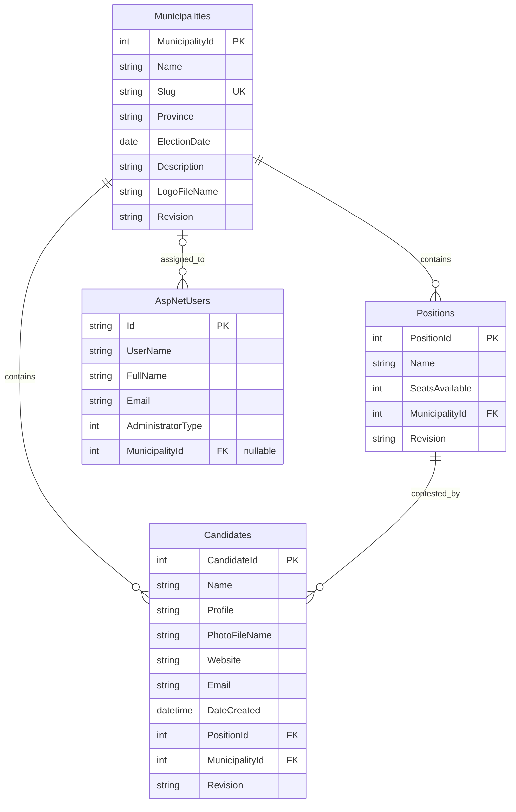

# C# database ERD

The active election and administrator model in `MEMS.Data` uses SQL Server and
EF Core Code First. The diagram shows core fields; nullable images/contact
fields, framework Identity details and seed bookkeeping are summarized below.

## Relationships and integrity

- Each position belongs to one municipality. Each candidate belongs to one
  municipality and one position in that same municipality.
- The composite foreign key `Candidates(PositionId, MunicipalityId)` references
  `Positions(PositionId, MunicipalityId)`. SQL Server rejects a candidate linked
  to another municipality's position, even outside the UI or repository.
- Municipality slugs are unique, lowercase URL segments. Municipality
  name/province and position name/municipality combinations are also unique.
- Seats must be positive; required names/biographies cannot be blank. Deleting
  a municipality/position is restricted while dependent election records exist;
  municipality administrator assignments also restrict municipality deletion.
- `Revision` is an optimistic concurrency token on the three election entities.
  Updates/deletes must use the value originally read.

## Identity and diagram scope

`ApplicationUser` maps to `AspNetUsers`. `AdministratorType` is 0 for ordinary
users, 1 for Super Admin and 2 for Municipality Administrator. A database check
requires a municipality for type 2 and none for types 0/1. Role membership is
validated against the type/assignment by application authorization.
The standard `AspNetRoles`/`AspNetUserRoles`, claims, logins and token tables
exist but are omitted from this diagram to keep it readable.

Optional image filenames, website/email and full name may be null. Seeded
records also have stable internal `SeedKey` values for repeatable seeding.

An unused legacy `SavedCandidates` table/model remains in the current migration.
It is omitted from this active-use diagram: there is no public voting-selection
API, and Blazor selections are stored only in browser `sessionStorage`.

See [entity configuration](../../MEMS.Data/Configuration/EntityConfigurations.cs),
[migrations](../../MEMS.Data/Migrations/) and [migration instructions](../../MEMS.Data/README.md).
