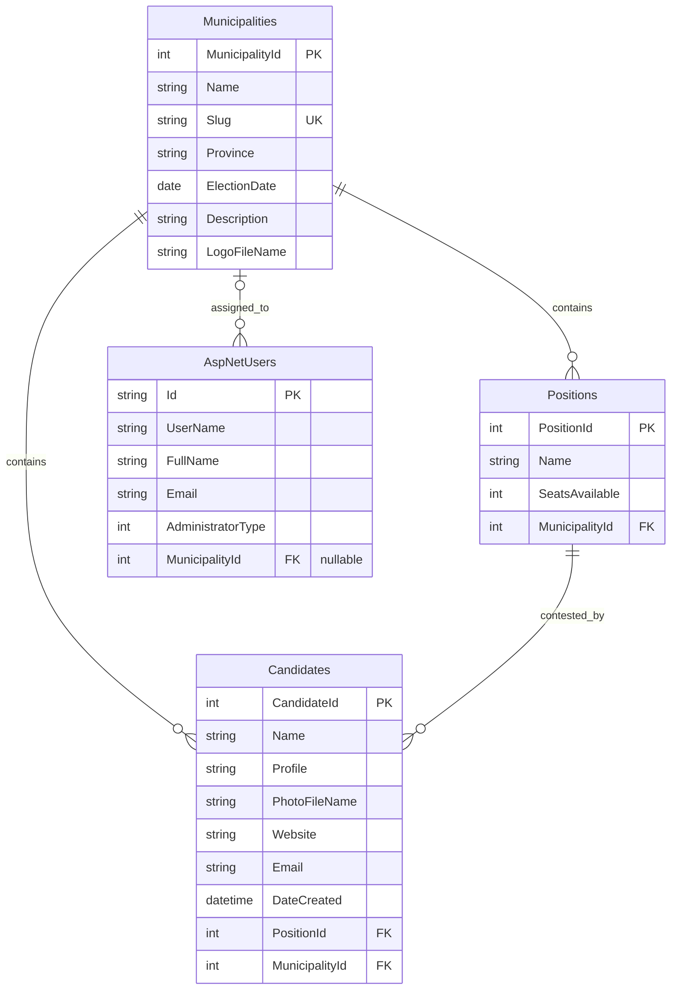

# C# database ERD

The active election and administrator model in `MEMS.Data` uses SQL Server and
EF Core Code First. The diagram shows core fields; nullable images/contact
fields, framework Identity details and seed bookkeeping are summarized below.

## Relationships and integrity

- Each position belongs to one municipality. Each candidate belongs to one
  municipality and one position in that same municipality.
- The composite foreign key `Candidates(PositionId, MunicipalityId)` references
  `Positions(PositionId, MunicipalityId)`. SQL Server rejects a candidate linked
  to another municipality's position, even outside the UI or repository.
- Municipality slugs are unique, lowercase URL segments. Municipality
  name/province and position name/municipality combinations are also unique.
