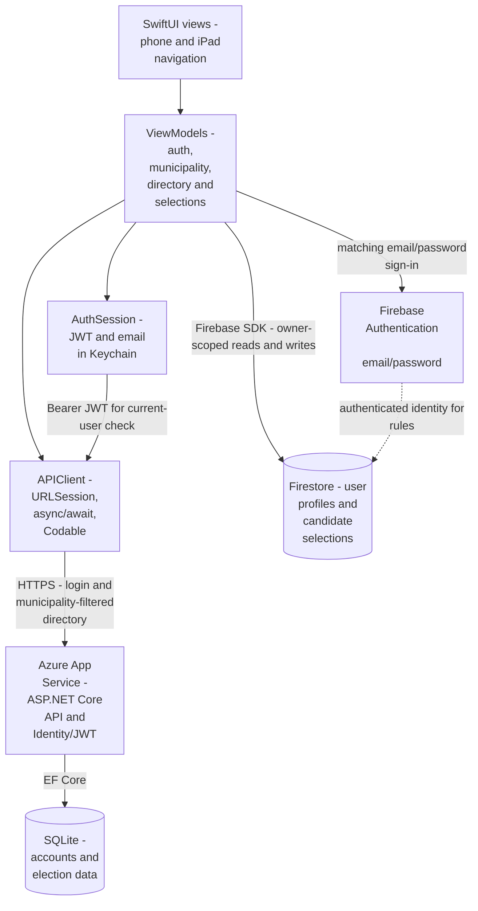

# iOS architecture

The SwiftUI app runs on iPhone and iPad. It uses an Azure-hosted API for
election information and Firebase for personal profiles and saved selections.

## Data flow

1. The user signs in through one login screen. The app establishes an API
   session and a Firebase session using matching email/password credentials.
   The API login token and email are stored in Keychain.
2. The user chooses a municipality. The app retrieves its positions, candidates
   and photograph URLs from the Azure API, which reads SQLite.
3. Firestore stores the user's preferred municipality, saved candidates and
   personal notes. Firebase authentication and security rules restrict access
   to the user's own records.
4. Changing municipality reloads the election information and shows selections
   for that municipality.

The iOS backend uses SQLite and is separate from the C# Aspire/SQL Server solution.

See the [data model](../erd/ERD.md) and [API reference](../api/API-ENDPOINTS.md).
