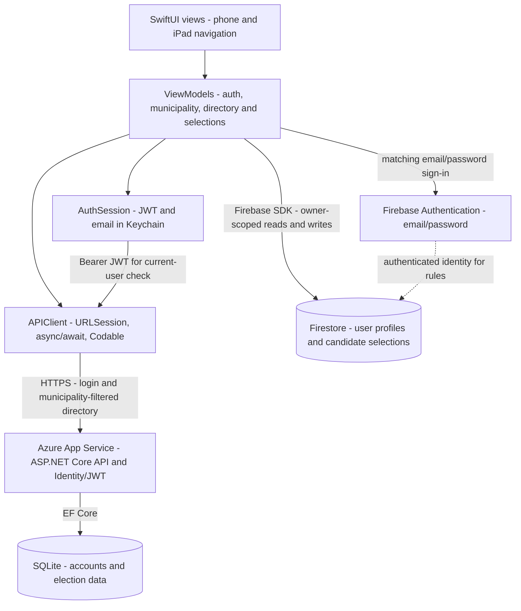

# iOS architecture

The app combines the existing election API with Firebase for personal data.
These are separate services with separate authentication; the C# Aspire/SQL
Server solution is not involved in this request flow.

## Data flow

1. Registration/login uses the Azure API. The JWT and email are held in Keychain;
   the app also establishes a Firebase Auth session for the same email.
2. The user chooses a municipality. Firestore `users/{lowercaseEmail}` persists
   the choice; Profile can change it later.
3. `APIClient` loads municipalities, positions and candidates. Candidate/position
   requests carry the selected municipality; stale results from a previous
   selection are discarded when the user changes city.
4. Candidate details and My Candidate Selections use Firestore
   `CandidateSelections` for notes and selections. Queries filter both owner
   email and current municipality. Profile also displays selection counts and
   last-sync information.
5. Logout clears the Keychain session and signs out of Firebase. Expired/rejected
   API sessions clear authenticated app state. The current-user check requires
   the updated Azure `/api/auth/me` endpoint for authoritative validation;
   unavailable/older deployments may temporarily retain a locally valid session.

## Responsibilities and boundaries

| Layer | Responsibility |
| --- | --- |
| Views | SwiftUI forms, lists/details, adaptive layouts and confirmation UI. |
| ViewModels | Loading/error state, validation, navigation context and city changes. |
| API services | Async HTTP, decoding, directory filters and JWT current-user check. |
| Firebase services | Profile persistence, selection CRUD and transaction coordination. |
| Azure API | Identity accounts/JWT and read-only election directory with image URLs. |
| Firestore rules | Authenticated email ownership, field validation and selection revision updates. |

An ASP.NET JWT cannot authenticate Firestore rules. This implementation uses
Firebase Email/Password authentication, not backend custom-token exchange.
The API and Firebase password stores have independent account lifecycles.
Never authorize Firestore from a client-supplied email without Firebase Auth.

Selection writes use transactions and a profile revision counter to coordinate
concurrent app operations. The app obtains seat limits from the API; Firestore
rules cannot verify those external limits themselves. Existing SQL saved-guide
tables are historical only; there are no active `/api/savedcandidates` routes.

SQLite and uploaded election images require persistent Azure storage. Firebase
stores mobile preferences/selections independently. IDs refer to this API's
SQLite dataset, not the new MEMS SQL Server dataset.

See [setup](../README.md), [data model](../erd/ERD.md),
[API reference](../api/API-ENDPOINTS.md) and [Firestore rules](../../firestore.rules).
