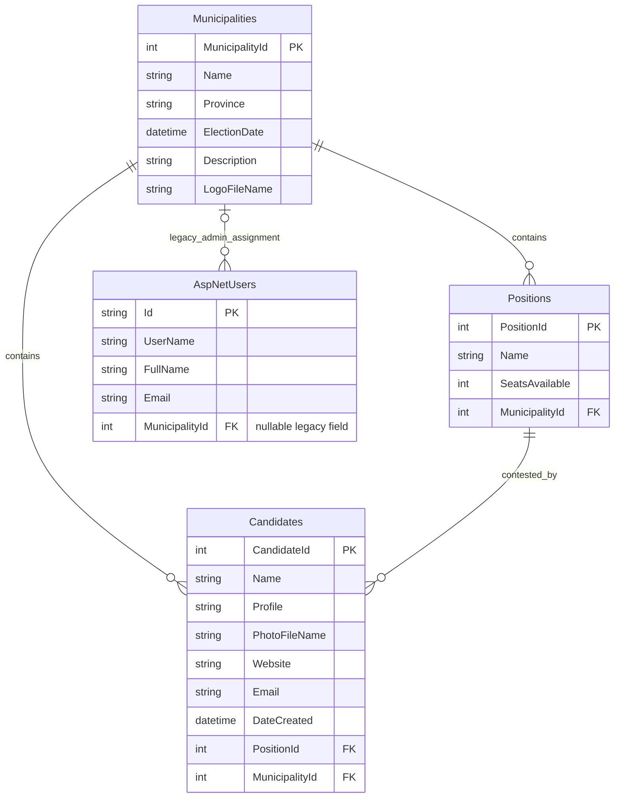
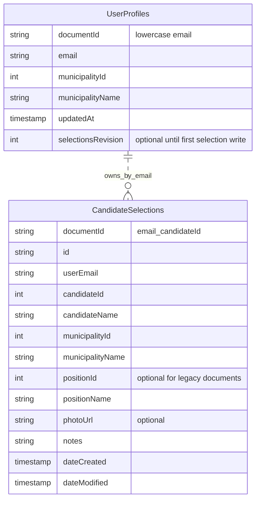

# iOS data model

Election/account data lives in the Azure API's SQLite database. Preferred
municipality and personal candidate selections live in Firestore. They are
separate stores; there are no foreign keys between SQLite and Firestore.

## SQLite election and account data

Candidates must reference a position in the same municipality, enforced by a
composite `(PositionId, MunicipalityId)` foreign key. API filters also keep
returned candidates and nested municipality/position data in the requested city.
The election date belongs to the municipality; there is no separate election
resource or office table (`Positions` represents offices).

The diagram omits standard Identity tables, concurrency/seed bookkeeping, and
historical `SavedCandidates`/`MunicipalityAdminGroups` tables. Those mappings and
migrations remain for database compatibility; the API does not use them to save
mobile selections. The optional SQL user municipality is legacy administrative
metadata, not the mobile user's preferred municipality.

## Firestore documents

This is a logical document model. The dotted relationship below means a shared
owner email, not a relational foreign key or automatic cascade.

| Collection / path | Purpose |
| --- | --- |
| `users/{lowercaseEmail}` | Selected municipality and transaction revision for one Firebase user. |
| `CandidateSelections/{lowercaseEmail}_{candidateId}` | One user's selection of one candidate, including display data and notes. |

Candidate/position/municipality IDs are logical references to the SQLite API.
Names and the optional image URL are copied for display. Deterministic document
IDs prevent duplicate selections of the same candidate by the same owner.
Profile and selection dates use server timestamps; notes are limited to 500
characters. Queries use owner email plus the current municipality, so switching
cities hides rather than deletes selections made for another city.

[`firestore.rules`](../../firestore.rules) requires Firebase-authenticated email
ownership and validates fields. Selection create/delete and note edits require
an atomic increment of the owner's profile revision. Profile deletion is denied
to prevent resetting that coordination state. Position seat limits are checked
using API data in the app, not independently by Firestore rules.

See [architecture](../architecture/ARCHITECTURE.md) and
[API contracts](../api/API-ENDPOINTS.md).
