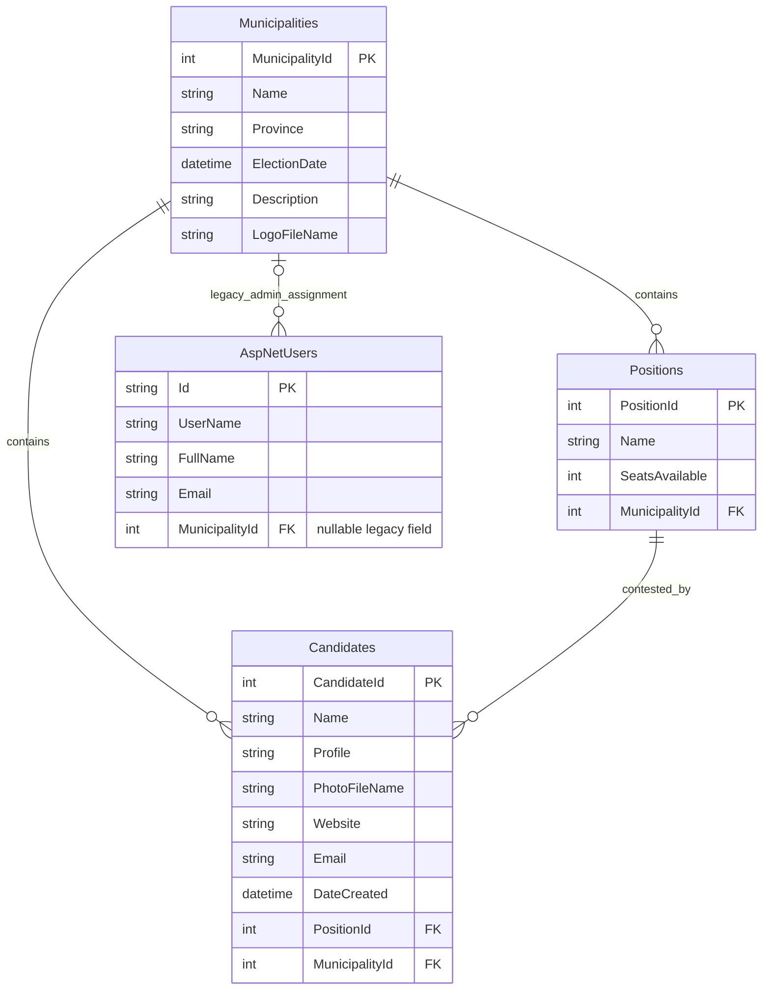
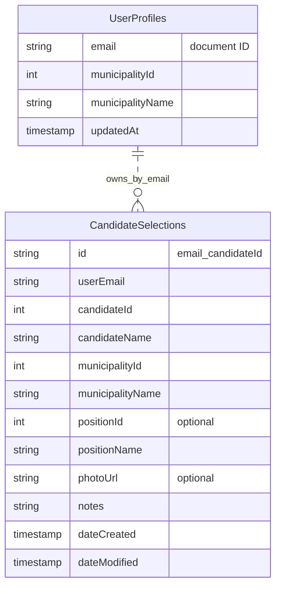

# iOS data model

These diagrams show the main election/account data in SQLite and personal
profiles/selections in Firestore. Candidates use positions in the same
municipality; the dotted Firestore relationship represents ownership by email.

## SQLite election and account data

## Firestore documents

